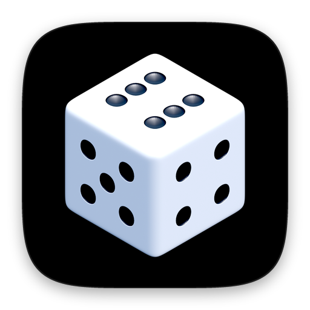

  

<h1 align="center">Dice Guess</h1>

A logic game. Picture the dice rolling along the track and guess which number lands face up.

  
  &nbsp;
  
  &nbsp;
  

Godot 4 · GDScript · Steam · iOS · Android

## About the code

I wrote it in 2024. One codebase builds the Steam version for Windows, macOS and Linux and the mobile versions.

Art, sounds, fonts and third-party addons are not included, so the game can't be built from this repo.

© 2024 Indest OÜ. All rights reserved.
